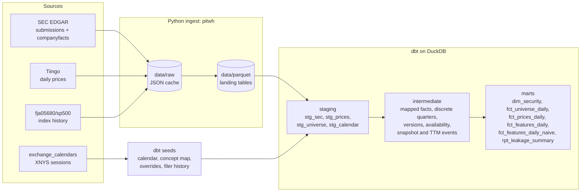

# pit-equity-warehouse

Most "backtest-ready" fundamentals leak the future. A quarter's revenue is usually stamped with the quarter-end date, but the market only learns it when the 10-Q is accepted by the SEC weeks later, and a restatement years afterwards silently replaces the number everyone traded on. Universes built from today's index members leak too: they drop every company that failed or was acquired. This repo builds a **point-in-time (PIT)** daily feature warehouse from SEC XBRL filings and Tiingo prices over a sampled S&P 500 history that keeps departed members. Every value is keyed on the session it became public. It then builds the same features the naive way and measures how much the naive version leaks, with a dbt test that fails on any look-ahead.

<!-- BENCH:START -->
_Generated by `bench/run_benchmarks.py` on 2026-11-11. 203 securities (89 left the index), universe 2015-01-01 to 2026-08-18._

**Look-ahead leakage in the naive model** (feature rows with a value)

| Metric | Value |
|---|---:|
| Naive rows that differ from PIT or cite a not-yet-public filing | **66.92%** (1,606,270 of 2,400,359) |
| Naive rows whose value differs from PIT (stricter) | 39.11% (938,885) |
| Median look-ahead, leaky rows | **373 days** |
| p90 look-ahead | 668 days |
| Restated versions handled point-in-time | 9,006 |
| Quarters derived from YTD or annual filings | 6,796 |

**As-of join, median of 5 runs after 1 warm-up** (identical output asserted)

| Securities | Grid rows | DuckDB `ASOF JOIN` | Correlated subquery | Window `LAST_VALUE` | ASOF speed-up vs slowest |
|---:|---:|---:|---:|---:|---:|
| 50 | 735,784 | 43 ms | 227 ms | 63 ms | 5.2x |
| 100 | 1,319,045 | 92 ms | 526 ms | 124 ms | 5.7x |
| 200 | 2,575,160 | 213 ms | 892 ms | 189 ms | 4.2x |

| Build and data | |
|---|---|
| Cold `dbt seed` + `dbt build`, all securities | 35 s (seed 3 s, build 32 s) |
| Mart rows | `dim_security` 308, `fct_universe_daily` 371,937, `fct_prices_daily` 478,552, `fct_features_daily` 371,937, `fct_features_daily_naive` 371,937, `rpt_leakage_summary` 7 |
| Securities with Tiingo prices | 181 of 203 (the rest are departed names Tiingo does not serve) |
| Daily returns reconciled to vendor | 478,371 (1 reviewed vendor-side exception) |
| Raw cache / DuckDB file | 1,275 MB / 97 MB |
| Tests | 82 dbt data tests, 13 dbt unit tests, 55 pytest tests |

<details><summary>XBRL tag fallbacks: how often a metric came from a lower-priority tag</summary>

| Metric | Mapped facts | From a fallback tag | Fallback tags used |
|---|---:|---:|---|
| eps_diluted | 46,167 | 0.0% |  |
| net_income | 44,283 | 0.0% |  |
| revenue | 43,734 | 44.0% | RevenueFromContractWithCustomerExcludingAssessedTax, SalesRevenueNet |
| shares_outstanding | 10,561 | 0.0% |  |
| stockholders_equity | 27,644 | 0.0% |  |
| total_assets | 24,864 | 0.0% |  |
| total_liabilities | 15,296 | 0.0% |  |

</details>

_Machine: Apple M4, 10 cores, 24 GB RAM, Darwin 27.0.0 (arm64), DuckDB 2.0.0._
<!-- BENCH:END -->

## Architecture



The PIT features are one `ASOF LEFT JOIN` from the daily universe grid onto a table of snapshot events: "as of this session, the state of (security, metric) is (period, value)". `fct_features_daily` and `fct_features_daily_naive` share that join (the `daily_features()` macro) and differ only in how the events are built.

## Two gotchas in SEC data

**1. There is no Q4 10-Q.** Companies file three 10-Qs and a 10-K, and flow items in 10-Qs are often year-to-date. A discrete quarter has to be derived: Q2 = 6M YTD minus Q1, Q4 = fiscal year minus 9M YTD. Apple's fiscal Q4 2023 is in no filing. Derived from the 10-K accepted after the close on 2023-11-02, it comes out at revenue $89.498B and net income $22.956B, which match Apple's reported quarter. It becomes available on 2023-11-03, the first session that opens after acceptance. The 9M figure subtracted is the one known *at that 10-K*, not a later restated one, so the derived value is something an analyst could have computed that day. EPS is never derived, because share counts change between quarters.

**2. A 10-K is full of old numbers.** The FY2023 10-K also reports FY2022 and FY2021 net income, and every balance sheet repeats last year's. A "most recently filed value" lookup jumps backwards to those comparatives. The snapshot rule works in two steps. First take the latest *period* with any version available. Then, for that period, take the most recently accepted version. That way comparatives never pull the state backwards, but a genuine restatement of the current period does replace it. Kraft Heinz is the restatement case: it reported Q1 2017 net income of $893M in May 2017, then restated it to $883M in a delayed 10-K in June 2019. The PIT model shows $893M until 2019-06-10; the naive model shows $883M from the quarter end onward.

Both examples run as tests on real filings in the CI fixtures (`tests/test_dbt_fixtures.py`).

## How the leakage test works

Every feature column carries `<metric>_source_available_date`, the first session that opened after the source filing was accepted (SEC `acceptanceDateTime`, which is true UTC; see [decisions](docs/decisions.md)). `assert_no_lookahead` fails if any row of `fct_features_daily` uses a source that becomes available after its trade date.

A test that can only pass proves nothing. `assert_naive_model_leaks` runs the same check (the shared `lookahead_rows` macro) on `fct_features_daily_naive`, which keys values on period end and takes the latest version. It **fails if it finds no leaks**. If the PIT check were broken, say comparing the wrong column, the naive model would stop leaking under it and the build would fail.

Returns are checked the same way: each day's total return, computed from that day's raw close, dividend and split, must match the day-over-day ratio of Tiingo's adjusted close within 1e-4. The check is daily, not compounded, so a failure names the day. Corrupting one close by 1% fails exactly the two affected days. Days traced to a vendor-side error are listed with evidence in `dbt/seeds/reconciliation_exceptions.csv`; any other mismatch fails the build.

## Quickstart

```bash
cp .env.example .env    # set SEC_USER_AGENT and TIINGO_API_KEY
make setup && make all  # ingest -> build -> test -> bench
```

`make ingest` caches every download in `data/raw`, so a rerun only fetches what is missing. On Tiingo's free plan (50 requests an hour), the first price download takes about four hours.

Offline, from the committed fixtures (five companies, real responses, no keys needed). This is what CI runs:

```bash
make test build-fixtures
docker build -t pitwh . && docker run --rm pitwh   # same, in a container
```

## Data sources, licenses and limitations

- **SEC EDGAR** submissions and companyfacts (public domain). Requests are throttled to 8 per second, under SEC's 10, and send a declared User-Agent.
- **Tiingo** end-of-day prices. The raw cache is not committed. The CI fixtures include trimmed Tiingo price histories for five companies; check Tiingo's terms before publishing them.
- **S&P 500 membership history** from [fja05680/sp500](https://github.com/fja05680/sp500) (MIT), pinned to one commit. The universe is a **seeded sample**: 200 draws, plus 3 predecessors split out of mergers. It is not the full index.
- **Departed names without prices.** Tiingo serves delisted tickers, but only the current holder of a reused ticker. Departed companies whose ticker was later reused stay in the universe with fundamentals and null returns, so return statistics under-represent failed and acquired names. The table above gives the count.
- **XBRL tag mapping** uses a priority list per metric (`dbt/seeds/concept_map.csv`), chosen within each filing. Fallback usage is in the table above; only revenue needed one. `total_liabilities` has the thinnest coverage, because many balance sheets have no total-liabilities line to tag.
- **EPS has a Q4 gap.** Diluted EPS is not additive, so a Q4 that only appears in the 10-K's annual figure is not derived. `eps_diluted` keeps the Q3 value until the next 10-Q.
- **Timezone.** `acceptanceDateTime` ends in `Z` and is true UTC, confirmed against EDGAR index pages (4 h gap in daylight time, 5 h otherwise). A filing accepted at 16:05 ET is available the next session; one at 07:30 ET is available the same day.
- **Ticker-to-CIK resolution.** 50 ticker intervals were resolved by hand from EDGAR. Reorganizations that change the filer (new holding companies, spin-merges) are chained in `dbt/seeds/filer_history.csv`, with the EDGAR evidence for each.

Every non-obvious choice, with the alternatives considered, is in [docs/decisions.md](docs/decisions.md).

## What I'd do next

- Add a second price source for departed names whose ticker was reused (CRSP or a paid Tiingo tier), and reconcile the two.
- Derive total liabilities as `LiabilitiesAndStockholdersEquity` minus equity (including minority interest) for filers that don't tag `Liabilities`.
- Use dimensional XBRL to tell segment contexts apart where companyfacts collapses them.
- Load incrementally: refetch only filers with new accessions and rebuild the affected partitions.
- Add analyst-style features (growth rates, accruals) on top of the PIT events, each with its own source date.
